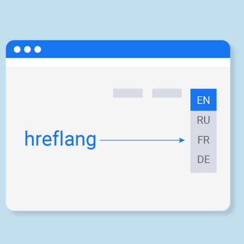

<div align="center">



# Hreflang x-default for PrestaShop

**The one hreflang tag PrestaShop does not output, added in 30 seconds. Free, no theme edits.**

[](https://www.prestashop.com)
[](https://github.com/iamadlx/PrestaShop-hreflang-x-default/releases/latest)
[](https://github.com/iamadlx/PrestaShop-hreflang-x-default/releases)
[](LICENSE)

[Download the latest zip](https://github.com/iamadlx/PrestaShop-hreflang-x-default/releases/latest) · [Install](#install-in-30-seconds) · [FAQ](#faq)

</div>

---

## The problem

A multilingual PrestaShop store already tells Google which URL serves which language. Open the source
of any page and you will find one `hreflang` line per language. What is missing is the **fallback**:
the URL Google should show to a visitor whose language you do not offer.

```html
<!-- What PrestaShop 8 outputs on a 6-language store -->
<link rel="alternate" href="https://example.com/en/8-cpap-masks"     hreflang="en">
<link rel="alternate" href="https://example.com/fr/8-masques-cpap"   hreflang="fr">
<link rel="alternate" href="https://example.com/nl/8-cpap-maskers"   hreflang="nl">
<link rel="alternate" href="https://example.com/de/8-cpap-masken"    hreflang="de">
<link rel="alternate" href="https://example.com/es/8-mascarillas-cpap" hreflang="es">
<link rel="alternate" href="https://example.com/it/8-maschere-cpap"  hreflang="it">

<!-- What this module adds -->
<link rel="alternate" hreflang="x-default" href="https://example.com/en/8-cpap-masks" />
```

Without `x-default`, a visitor searching in Polish or Swedish may land on whichever version Google
picks. With it, you decide: usually your English pages.

## What it does

- **Adds `hreflang="x-default"`** on every front page, pointing to the same page in the language you choose.
- **Never duplicates a tag.** If your theme already outputs `x-default`, the module stays silent.
- **No theme edits.** Injected through the standard `displayHeader` hook, so theme updates cannot break it.
- **Lightweight.** No database table, no cron, no external call: one line of HTML built from data PrestaShop already has.
- **Translatable.** Back office in English, with French included; any other language can be translated from **International > Translations**.
- **Theme override friendly.** Copy the template to `themes/<your-theme>/modules/pshreflangxdefault/views/templates/hook/xdefault.tpl` to change the markup.

## Install in 30 seconds

1. Download `pshreflangxdefault-x.y.z.zip` from the [latest release](https://github.com/iamadlx/PrestaShop-hreflang-x-default/releases/latest).
2. Back office: **Modules > Module Manager > Upload a module**, drop the zip.
3. Click **Configure**, switch the module **on**, choose the **x-default language**, save.
4. Clear the cache: **Advanced Parameters > Performance > Clear cache**.

### Check that it works

Open any page of your store, view the source (Ctrl+U or Cmd+Option+U) and search for `x-default`.
Or from a terminal:

```bash
curl -s https://your-store.com/ | grep -i 'x-default'
```

## Compatibility

| PrestaShop | Status |
|---|---|
| 1.7.8 | supported |
| 8.0 to 8.2 | supported, running in production on 8.2.8 |
| 9.x | not declared yet: the module refuses to install until it has been tested |

Runs on the same PHP versions as PrestaShop itself. Works with any theme that calls the standard `displayHeader` hook (Classic, Hummingbird
and the large majority of commercial themes).

## FAQ

**Doesn't PrestaShop already handle hreflang?**
Partly. PrestaShop 8 outputs one `hreflang` tag per active language and a `canonical` tag on products,
categories, CMS pages and paginated lists, with filters stripped. It does not output `x-default`. That
single gap is what this module fills, and nothing more.

**Which language should I pick as x-default?**
The one most of your international visitors can read, usually English. If your store has no English,
pick your main language.

**My hreflang codes look like `es-es` or `it-it`. Is that a problem?**
It narrows the target: `es-es` tells Google the page is for Spain only, not for other Spanish speakers.
The value comes from **International > Languages > Language code**. Setting it to `es`, `it`, `fr`...
targets everyone who speaks the language. Prices and dates are not affected: they use the separate
*locale* field.

**Does it need a cron job, an API key or a database table?**
No. Install, choose a language, done.

**Will it slow my store down?**
No. It builds one URL from data already loaded for the page and prints one line of HTML.

**Multistore?**
The setting is stored per shop context, like any PrestaShop configuration value.

## Uninstall

Module Manager, then Uninstall. The module removes its two configuration values and leaves nothing behind.

## Contributing

Issues and pull requests are welcome. Please describe your PrestaShop version, theme and the
`hreflang` lines you see in the page source.

## Hosting recommendation (optional)

Looking for a host with **1-click PrestaShop installation**, easy updates and automatic backups?
Infomaniak offers a dedicated PrestaShop hosting plan (affiliate link):
[infomaniak.com, PrestaShop hosting](https://www.infomaniak.com/fr/creer-un-site/cms/hebergement-prestashop?utm_term=5f980010e7533)

## License

[MIT](LICENSE). Copyright (c) 2026 ADLX.

Built and maintained by [ADLX Studio](https://adlx.studio), from Belgium.
More PrestaShop modules on [github.com/iamadlx](https://github.com/iamadlx).
